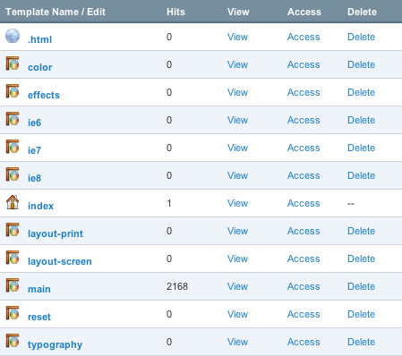

In our years of working with ExpressionEngine, we’ve tweaked our standard setup quite a few times. We generally handle most every asset, including CSS and JavaScript, as a template. Being a bit obsessed with organization and overall maintainability of code, we separate out our styles and scripts into separate templates for each major concern (e.g. typography, color, screen layout, etc.).

<figure></figure>

A while back, it was not uncommon for us to include each of these assets into the document separately, but, as website optimization and performance folks will tell you, all of that separation leads to a lot of additional overhead because the browser must request each of those files individually. In the interest of streamlining the download process, we decided to merge all of the stylesheets together at the template level before sending them over the wire. Here’s the simple recipe we devised:

<link href="https://github.githubassets.com/assets/gist-embed-c77408be8058.css" rel="stylesheet"/>
 
 
 
 
 
 
 <template class="js-file-alert-template"> 
 <svg aria-hidden="true" class="octicon octicon-alert" data-view-component="true" height="16" version="1.1" viewbox="0 0 16 16" width="16"> <path d="M6.457 1.047c.659-1.234 2.427-1.234 3.086 0l6.082 11.378A1.75 1.75 0 0 1 14.082 15H1.918a1.75 1.75 0 0 1-1.543-2.575Zm1.763.707a.25.25 0 0 0-.44 0L1.698 13.132a.25.25 0 0 0 .22.368h12.164a.25.25 0 0 0 .22-.368Zm.53 3.996v2.5a.75.75 0 0 1-1.5 0v-2.5a.75.75 0 0 1 1.5 0ZM9 11a1 1 0 1 1-2 0 1 1 0 0 1 2 0Z"></path></svg>       This file contains bidirectional Unicode text that may be interpreted or compiled differently than what appears below. To review, open the file in an editor that reveals hidden Unicode characters.      <a class="Link--inTextBlock" href="https://github.co/hiddenchars" target="_blank">Learn more about bidirectional Unicode characters</a>  
 <a class="btn-sm btn" data-view-component="true" href="/archives/template-based-asset-munging-in-expressionengine/{{ revealButtonHref }}">    Show hidden characters</a>

</template><template class="js-line-alert-template">  <svg aria-hidden="true" class="octicon octicon-alert" data-view-component="true" height="16" version="1.1" viewbox="0 0 16 16" width="16"> <path d="M6.457 1.047c.659-1.234 2.427-1.234 3.086 0l6.082 11.378A1.75 1.75 0 0 1 14.082 15H1.918a1.75 1.75 0 0 1-1.543-2.575Zm1.763.707a.25.25 0 0 0-.44 0L1.698 13.132a.25.25 0 0 0 .22.368h12.164a.25.25 0 0 0 .22-.368Zm.53 3.996v2.5a.75.75 0 0 1-1.5 0v-2.5a.75.75 0 0 1 1.5 0ZM9 11a1 1 0 1 1-2 0 1 1 0 0 1 2 0Z"></path></svg></template> <table class="highlight tab-size js-file-line-container js-code-nav-container js-tagsearch-file" data-hpc="" data-paste-markdown-skip="" data-tab-size="8" data-tagsearch-lang="CSS" data-tagsearch-path="main.css"> <tr> <td class="blob-num js-line-number js-code-nav-line-number js-blob-rnum" data-line-number="1" id="file-main-css-L1"></td> <td class="blob-code blob-code-inner js-file-line" id="file-main-css-LC1">/* ———————————</td> </tr> <tr> <td class="blob-num js-line-number js-code-nav-line-number js-blob-rnum" data-line-number="2" id="file-main-css-L2"></td> <td class="blob-code blob-code-inner js-file-line" id="file-main-css-LC2"> * Core Stylesheet</td> </tr> <tr> <td class="blob-num js-line-number js-code-nav-line-number js-blob-rnum" data-line-number="3" id="file-main-css-L3"></td> <td class="blob-code blob-code-inner js-file-line" id="file-main-css-LC3"> * Created by Easy! Designs, LLC</td> </tr> <tr> <td class="blob-num js-line-number js-code-nav-line-number js-blob-rnum" data-line-number="4" id="file-main-css-L4"></td> <td class="blob-code blob-code-inner js-file-line" id="file-main-css-LC4"> * http://easy-designs.net</td> </tr> <tr> <td class="blob-num js-line-number js-code-nav-line-number js-blob-rnum" data-line-number="5" id="file-main-css-L5"></td> <td class="blob-code blob-code-inner js-file-line" id="file-main-css-LC5"> * ——————————— */</td> </tr> <tr> <td class="blob-num js-line-number js-code-nav-line-number js-blob-rnum" data-line-number="6" id="file-main-css-L6"></td> <td class="blob-code blob-code-inner js-file-line" id="file-main-css-LC6"></td> </tr> <tr> <td class="blob-num js-line-number js-code-nav-line-number js-blob-rnum" data-line-number="7" id="file-main-css-L7"></td> <td class="blob-code blob-code-inner js-file-line" id="file-main-css-LC7">{embed="styles/reset"}</td> </tr> <tr> <td class="blob-num js-line-number js-code-nav-line-number js-blob-rnum" data-line-number="8" id="file-main-css-L8"></td> <td class="blob-code blob-code-inner js-file-line" id="file-main-css-LC8"></td> </tr> <tr> <td class="blob-num js-line-number js-code-nav-line-number js-blob-rnum" data-line-number="9" id="file-main-css-L9"></td> <td class="blob-code blob-code-inner js-file-line" id="file-main-css-LC9">{embed="styles/typography"}</td> </tr> <tr> <td class="blob-num js-line-number js-code-nav-line-number js-blob-rnum" data-line-number="10" id="file-main-css-L10"></td> <td class="blob-code blob-code-inner js-file-line" id="file-main-css-LC10"></td> </tr> <tr> <td class="blob-num js-line-number js-code-nav-line-number js-blob-rnum" data-line-number="11" id="file-main-css-L11"></td> <td class="blob-code blob-code-inner js-file-line" id="file-main-css-LC11">@media screen {</td> </tr> <tr> <td class="blob-num js-line-number js-code-nav-line-number js-blob-rnum" data-line-number="12" id="file-main-css-L12"></td> <td class="blob-code blob-code-inner js-file-line" id="file-main-css-LC12">  {embed="styles/layout-screen"}</td> </tr> <tr> <td class="blob-num js-line-number js-code-nav-line-number js-blob-rnum" data-line-number="13" id="file-main-css-L13"></td> <td class="blob-code blob-code-inner js-file-line" id="file-main-css-LC13">}</td> </tr> <tr> <td class="blob-num js-line-number js-code-nav-line-number js-blob-rnum" data-line-number="14" id="file-main-css-L14"></td> <td class="blob-code blob-code-inner js-file-line" id="file-main-css-LC14"></td> </tr> <tr> <td class="blob-num js-line-number js-code-nav-line-number js-blob-rnum" data-line-number="15" id="file-main-css-L15"></td> <td class="blob-code blob-code-inner js-file-line" id="file-main-css-LC15">@media print {</td> </tr> <tr> <td class="blob-num js-line-number js-code-nav-line-number js-blob-rnum" data-line-number="16" id="file-main-css-L16"></td> <td class="blob-code blob-code-inner js-file-line" id="file-main-css-LC16">  {embed="styles/layout-print"}</td> </tr> <tr> <td class="blob-num js-line-number js-code-nav-line-number js-blob-rnum" data-line-number="17" id="file-main-css-L17"></td> <td class="blob-code blob-code-inner js-file-line" id="file-main-css-LC17">}</td> </tr> <tr> <td class="blob-num js-line-number js-code-nav-line-number js-blob-rnum" data-line-number="18" id="file-main-css-L18"></td> <td class="blob-code blob-code-inner js-file-line" id="file-main-css-LC18"></td> </tr> <tr> <td class="blob-num js-line-number js-code-nav-line-number js-blob-rnum" data-line-number="19" id="file-main-css-L19"></td> <td class="blob-code blob-code-inner js-file-line" id="file-main-css-LC19">{embed="styles/color"}</td> </tr> <tr> <td class="blob-num js-line-number js-code-nav-line-number js-blob-rnum" data-line-number="20" id="file-main-css-L20"></td> <td class="blob-code blob-code-inner js-file-line" id="file-main-css-LC20"></td> </tr> <tr> <td class="blob-num js-line-number js-code-nav-line-number js-blob-rnum" data-line-number="21" id="file-main-css-L21"></td> <td class="blob-code blob-code-inner js-file-line" id="file-main-css-LC21">{embed="styles/effects"}</td> </tr> </table>
 
 

 
 
 <a class="Link--inTextBlock" href="https://gist.github.com/aarongustafson/471560/raw/66df969007bfd332452767cee48f8c15b84045d9/main.css" style="float:right">view raw</a> <a class="Link--inTextBlock" href="https://gist.github.com/aarongustafson/471560#file-main-css">          main.css        </a>        hosted with ❤ by <a class="Link--inTextBlock" href="https://github.com">GitHub</a> 
 

This framework allows us to pull in each template in the optimum way for progressive enhancement with only a single download on the user end, which is much faster. And server-side caching only adds to the speed improvements. Beyond that, we can continue to add new <code class="css">@media</code> blocks (including media queries) as necessary either within the embedded files or in this master one.

We use a similar setup for our JavaScript:

<link href="https://github.githubassets.com/assets/gist-embed-c77408be8058.css" rel="stylesheet"/>
 
 
 
 
 
 
 <template class="js-file-alert-template"> 
 <svg aria-hidden="true" class="octicon octicon-alert" data-view-component="true" height="16" version="1.1" viewbox="0 0 16 16" width="16"> <path d="M6.457 1.047c.659-1.234 2.427-1.234 3.086 0l6.082 11.378A1.75 1.75 0 0 1 14.082 15H1.918a1.75 1.75 0 0 1-1.543-2.575Zm1.763.707a.25.25 0 0 0-.44 0L1.698 13.132a.25.25 0 0 0 .22.368h12.164a.25.25 0 0 0 .22-.368Zm.53 3.996v2.5a.75.75 0 0 1-1.5 0v-2.5a.75.75 0 0 1 1.5 0ZM9 11a1 1 0 1 1-2 0 1 1 0 0 1 2 0Z"></path></svg>       This file contains bidirectional Unicode text that may be interpreted or compiled differently than what appears below. To review, open the file in an editor that reveals hidden Unicode characters.      <a class="Link--inTextBlock" href="https://github.co/hiddenchars" target="_blank">Learn more about bidirectional Unicode characters</a>  
 <a class="btn-sm btn" data-view-component="true" href="/archives/template-based-asset-munging-in-expressionengine/{{ revealButtonHref }}">    Show hidden characters</a>

</template><template class="js-line-alert-template">  <svg aria-hidden="true" class="octicon octicon-alert" data-view-component="true" height="16" version="1.1" viewbox="0 0 16 16" width="16"> <path d="M6.457 1.047c.659-1.234 2.427-1.234 3.086 0l6.082 11.378A1.75 1.75 0 0 1 14.082 15H1.918a1.75 1.75 0 0 1-1.543-2.575Zm1.763.707a.25.25 0 0 0-.44 0L1.698 13.132a.25.25 0 0 0 .22.368h12.164a.25.25 0 0 0 .22-.368Zm.53 3.996v2.5a.75.75 0 0 1-1.5 0v-2.5a.75.75 0 0 1 1.5 0ZM9 11a1 1 0 1 1-2 0 1 1 0 0 1 2 0Z"></path></svg></template> <table class="highlight tab-size js-file-line-container js-code-nav-container js-tagsearch-file" data-hpc="" data-paste-markdown-skip="" data-tab-size="8" data-tagsearch-lang="JavaScript" data-tagsearch-path="main.js"> <tr> <td class="blob-num js-line-number js-code-nav-line-number js-blob-rnum" data-line-number="1" id="file-main-js-L1"></td> <td class="blob-code blob-code-inner js-file-line" id="file-main-js-LC1">{embed="javascripts/jquery.FunctionHandler"}</td> </tr> <tr> <td class="blob-num js-line-number js-code-nav-line-number js-blob-rnum" data-line-number="2" id="file-main-js-L2"></td> <td class="blob-code blob-code-inner js-file-line" id="file-main-js-LC2">{embed="javascripts/jquery.hoverIntent"}</td> </tr> <tr> <td class="blob-num js-line-number js-code-nav-line-number js-blob-rnum" data-line-number="3" id="file-main-js-L3"></td> <td class="blob-code blob-code-inner js-file-line" id="file-main-js-LC3">{embed="javascripts/eCSStender"}</td> </tr> <tr> <td class="blob-num js-line-number js-code-nav-line-number js-blob-rnum" data-line-number="4" id="file-main-js-L4"></td> <td class="blob-code blob-code-inner js-file-line" id="file-main-js-LC4"></td> </tr> <tr> <td class="blob-num js-line-number js-code-nav-line-number js-blob-rnum" data-line-number="5" id="file-main-js-L5"></td> <td class="blob-code blob-code-inner js-file-line" id="file-main-js-LC5">/* Individual page handlers go here */</td> </tr> </table>
 
 

 
 
 <a class="Link--inTextBlock" href="https://gist.github.com/aarongustafson/471560/raw/66df969007bfd332452767cee48f8c15b84045d9/main.js" style="float:right">view raw</a> <a class="Link--inTextBlock" href="https://gist.github.com/aarongustafson/471560#file-main-js">          main.js        </a>        hosted with ❤ by <a class="Link--inTextBlock" href="https://github.com">GitHub</a> 
 

In this particular example, we’re including two jQuery plugins: <a href="http://github.com/easy-designs/FunctionHandler.js">FunctionHandler</a> and <a href="http://cherne.net/brian/resources/jquery.hoverIntent.html">hoverIntent</a>, along with <a href="http://eCSStender.org">eCSStender</a> before adding our <a href="/archives/a-new-onload-scheme/index.html">page-specific code in FunctionHandler registrations</a>. (jQuery itself is loaded in from Google.)

Using ExpressionEngine’s template system to manage the munging like this is dead simple and (from our experience evaluating other people’s EE setups) often underused. Give it a shot on your next project.

