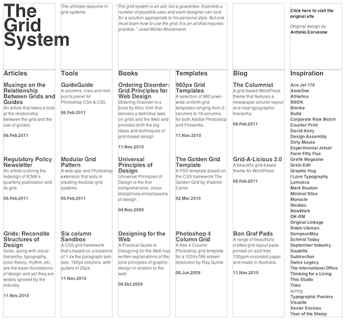

In preparation for the launch of <a href="http://10k.aneventapart.com/">10K Apart (Responsive Edition)</a> from <a href="http://visitmix.com/">Mix Online</a> and <a href="http://aneventapart.com/">An Event Apart</a>, I’ve been feverishly working on a modest implementation of <a href="http://dev.w3.org/csswg/css3-grid-align/">the proposed CSS3 Grid Layout module</a> (also referred to as Grid Alignment in <a href="http://www.interoperabilitybridges.com/css3-grid-align/">alternate drafts</a>) using <a href="http://eCSStender.org">eCSStender</a>. As you might imagine, it was a pretty massive undertaking, but it’s been pretty rewarding to use eCSStender for it’s original intent: prototyping implementations of proposed specifications.

<figure>  </figure>

As it stands today, the <a href="http://ie.microsoft.com/testdrive/">IE10 platform preview</a> is the only place you can play with CSS-based grid layouts and have them natively rendered by the browser. This JavaScript-based port, however, makes it possible to view them in recent builds of Chrome, Firefox, Safari and even Opera.

<h2>How do I use it?</h2>

As with most extensions, enabling grid layout with eCSStender is as simple as including <a href="http://ecsstender.org/documentation/downloading-ecsstender">the eCSStender core library</a> and <a href="http://ecsstender.org/extensions/css3-grid-alignment/">the Grid Alignment extension</a>. It’s up to you whether you’d like to download copies of each and serve them from your own domain or whether you prefer to use <a href="http://ecsstender.org/documentation/the-ecsstender-cdn/">the new eCSStender CDN</a> to handle the file delivery for you. To use the CDN, you’d simply include the following two scripts just before the closing <code class="html">body</code> tag:

<link href="https://github.githubassets.com/assets/gist-embed-c77408be8058.css" rel="stylesheet"/>
 
 
 
 
 
 
 <template class="js-file-alert-template"> 
 <svg aria-hidden="true" class="octicon octicon-alert" data-view-component="true" height="16" version="1.1" viewbox="0 0 16 16" width="16"> <path d="M6.457 1.047c.659-1.234 2.427-1.234 3.086 0l6.082 11.378A1.75 1.75 0 0 1 14.082 15H1.918a1.75 1.75 0 0 1-1.543-2.575Zm1.763.707a.25.25 0 0 0-.44 0L1.698 13.132a.25.25 0 0 0 .22.368h12.164a.25.25 0 0 0 .22-.368Zm.53 3.996v2.5a.75.75 0 0 1-1.5 0v-2.5a.75.75 0 0 1 1.5 0ZM9 11a1 1 0 1 1-2 0 1 1 0 0 1 2 0Z"></path></svg>       This file contains bidirectional Unicode text that may be interpreted or compiled differently than what appears below. To review, open the file in an editor that reveals hidden Unicode characters.      <a class="Link--inTextBlock" href="https://github.co/hiddenchars" target="_blank">Learn more about bidirectional Unicode characters</a>  
 <a class="btn-sm btn" data-view-component="true" href="/archives/experimenting-with-grids-using-ecsstender/{{ revealButtonHref }}">    Show hidden characters</a>

</template><template class="js-line-alert-template">  <svg aria-hidden="true" class="octicon octicon-alert" data-view-component="true" height="16" version="1.1" viewbox="0 0 16 16" width="16"> <path d="M6.457 1.047c.659-1.234 2.427-1.234 3.086 0l6.082 11.378A1.75 1.75 0 0 1 14.082 15H1.918a1.75 1.75 0 0 1-1.543-2.575Zm1.763.707a.25.25 0 0 0-.44 0L1.698 13.132a.25.25 0 0 0 .22.368h12.164a.25.25 0 0 0 .22-.368Zm.53 3.996v2.5a.75.75 0 0 1-1.5 0v-2.5a.75.75 0 0 1 1.5 0ZM9 11a1 1 0 1 1-2 0 1 1 0 0 1 2 0Z"></path></svg></template> <table class="highlight tab-size js-file-line-container js-code-nav-container js-tagsearch-file" data-hpc="" data-paste-markdown-skip="" data-tab-size="8" data-tagsearch-lang="HTML" data-tagsearch-path="script-inclusion.html"> <tr> <td class="blob-num js-line-number js-code-nav-line-number js-blob-rnum" data-line-number="1" id="file-script-inclusion-html-L1"></td> <td class="blob-code blob-code-inner js-file-line" id="file-script-inclusion-html-LC1">&lt;script src="http://cdn.ecsstender.org/lib/latest/min/eCSStender.js"&gt;&lt;/script&gt;</td> </tr> <tr> <td class="blob-num js-line-number js-code-nav-line-number js-blob-rnum" data-line-number="2" id="file-script-inclusion-html-L2"></td> <td class="blob-code blob-code-inner js-file-line" id="file-script-inclusion-html-LC2">&lt;script src="http://cdn.ecsstender.org/ext/CSS3-grid-alignment/latest/min/eCSStender.CSS3-grid-alignment.js"&gt;&lt;/script&gt;</td> </tr> </table>
 
 

 
 
 <a class="Link--inTextBlock" href="https://gist.github.com/aarongustafson/1126463/raw/4dce79fb7c22a5bdd08d5470ca0cadab3d6b58f4/script-inclusion.html" style="float:right">view raw</a> <a class="Link--inTextBlock" href="https://gist.github.com/aarongustafson/1126463#file-script-inclusion-html">          script-inclusion.html        </a>        hosted with ❤ by <a class="Link--inTextBlock" href="https://github.com">GitHub</a> 
 

With those in place, you can begin playing with some of the new grid syntax. <a href="http://test.ecsstender.org/extensions/eCSStender.CSS3-grid-alignment.js/test/grid-system/index.html">The test case</a> I built the extension against sets up one of several grids like this:

<link href="https://github.githubassets.com/assets/gist-embed-c77408be8058.css" rel="stylesheet"/>
 
 
 
 
 
 
 <template class="js-file-alert-template"> 
 <svg aria-hidden="true" class="octicon octicon-alert" data-view-component="true" height="16" version="1.1" viewbox="0 0 16 16" width="16"> <path d="M6.457 1.047c.659-1.234 2.427-1.234 3.086 0l6.082 11.378A1.75 1.75 0 0 1 14.082 15H1.918a1.75 1.75 0 0 1-1.543-2.575Zm1.763.707a.25.25 0 0 0-.44 0L1.698 13.132a.25.25 0 0 0 .22.368h12.164a.25.25 0 0 0 .22-.368Zm.53 3.996v2.5a.75.75 0 0 1-1.5 0v-2.5a.75.75 0 0 1 1.5 0ZM9 11a1 1 0 1 1-2 0 1 1 0 0 1 2 0Z"></path></svg>       This file contains bidirectional Unicode text that may be interpreted or compiled differently than what appears below. To review, open the file in an editor that reveals hidden Unicode characters.      <a class="Link--inTextBlock" href="https://github.co/hiddenchars" target="_blank">Learn more about bidirectional Unicode characters</a>  
 <a class="btn-sm btn" data-view-component="true" href="/archives/experimenting-with-grids-using-ecsstender/{{ revealButtonHref }}">    Show hidden characters</a>

</template><template class="js-line-alert-template">  <svg aria-hidden="true" class="octicon octicon-alert" data-view-component="true" height="16" version="1.1" viewbox="0 0 16 16" width="16"> <path d="M6.457 1.047c.659-1.234 2.427-1.234 3.086 0l6.082 11.378A1.75 1.75 0 0 1 14.082 15H1.918a1.75 1.75 0 0 1-1.543-2.575Zm1.763.707a.25.25 0 0 0-.44 0L1.698 13.132a.25.25 0 0 0 .22.368h12.164a.25.25 0 0 0 .22-.368Zm.53 3.996v2.5a.75.75 0 0 1-1.5 0v-2.5a.75.75 0 0 1 1.5 0ZM9 11a1 1 0 1 1-2 0 1 1 0 0 1 2 0Z"></path></svg></template> <table class="highlight tab-size js-file-line-container js-code-nav-container js-tagsearch-file" data-hpc="" data-paste-markdown-skip="" data-tab-size="8" data-tagsearch-lang="CSS" data-tagsearch-path="grid-object.css"> <tr> <td class="blob-num js-line-number js-code-nav-line-number js-blob-rnum" data-line-number="1" id="file-grid-object-css-L1"></td> <td class="blob-code blob-code-inner js-file-line" id="file-grid-object-css-LC1">#demo {</td> </tr> <tr> <td class="blob-num js-line-number js-code-nav-line-number js-blob-rnum" data-line-number="2" id="file-grid-object-css-L2"></td> <td class="blob-code blob-code-inner js-file-line" id="file-grid-object-css-LC2"> width:945px;</td> </tr> <tr> <td class="blob-num js-line-number js-code-nav-line-number js-blob-rnum" data-line-number="3" id="file-grid-object-css-L3"></td> <td class="blob-code blob-code-inner js-file-line" id="file-grid-object-css-LC3"> display:grid;</td> </tr> <tr> <td class="blob-num js-line-number js-code-nav-line-number js-blob-rnum" data-line-number="4" id="file-grid-object-css-L4"></td> <td class="blob-code blob-code-inner js-file-line" id="file-grid-object-css-LC4"> grid-columns: 145px 1fr 145px 1fr 145px 1fr 145px 1fr 145px 1fr 145px;</td> </tr> <tr> <td class="blob-num js-line-number js-code-nav-line-number js-blob-rnum" data-line-number="5" id="file-grid-object-css-L5"></td> <td class="blob-code blob-code-inner js-file-line" id="file-grid-object-css-LC5"> grid-rows: 186px 692px 357px; </td> </tr> <tr> <td class="blob-num js-line-number js-code-nav-line-number js-blob-rnum" data-line-number="6" id="file-grid-object-css-L6"></td> <td class="blob-code blob-code-inner js-file-line" id="file-grid-object-css-LC6">}</td> </tr> </table>
 
 

 
 
 <a class="Link--inTextBlock" href="https://gist.github.com/aarongustafson/1126463/raw/4dce79fb7c22a5bdd08d5470ca0cadab3d6b58f4/grid-object.css" style="float:right">view raw</a> <a class="Link--inTextBlock" href="https://gist.github.com/aarongustafson/1126463#file-grid-object-css">          grid-object.css        </a>        hosted with ❤ by <a class="Link--inTextBlock" href="https://github.com">GitHub</a> 
 

That code builds a grid structure within <code class="html">#demo</code> that is comprised of six primary columns (at 145px wide each) with equal-width “gutter” columns between them (their width is determined using equal division of the remaining space as indicated by “1fr” meaning “one fraction”). It also defines three rows of varying heights within <code class="html">#demo</code>. Grid items are then positioned on the grid using coordinate-like syntax:

<link href="https://github.githubassets.com/assets/gist-embed-c77408be8058.css" rel="stylesheet"/>
 
 
 
 
 
 
 <template class="js-file-alert-template"> 
 <svg aria-hidden="true" class="octicon octicon-alert" data-view-component="true" height="16" version="1.1" viewbox="0 0 16 16" width="16"> <path d="M6.457 1.047c.659-1.234 2.427-1.234 3.086 0l6.082 11.378A1.75 1.75 0 0 1 14.082 15H1.918a1.75 1.75 0 0 1-1.543-2.575Zm1.763.707a.25.25 0 0 0-.44 0L1.698 13.132a.25.25 0 0 0 .22.368h12.164a.25.25 0 0 0 .22-.368Zm.53 3.996v2.5a.75.75 0 0 1-1.5 0v-2.5a.75.75 0 0 1 1.5 0ZM9 11a1 1 0 1 1-2 0 1 1 0 0 1 2 0Z"></path></svg>       This file contains bidirectional Unicode text that may be interpreted or compiled differently than what appears below. To review, open the file in an editor that reveals hidden Unicode characters.      <a class="Link--inTextBlock" href="https://github.co/hiddenchars" target="_blank">Learn more about bidirectional Unicode characters</a>  
 <a class="btn-sm btn" data-view-component="true" href="/archives/experimenting-with-grids-using-ecsstender/{{ revealButtonHref }}">    Show hidden characters</a>

</template><template class="js-line-alert-template">  <svg aria-hidden="true" class="octicon octicon-alert" data-view-component="true" height="16" version="1.1" viewbox="0 0 16 16" width="16"> <path d="M6.457 1.047c.659-1.234 2.427-1.234 3.086 0l6.082 11.378A1.75 1.75 0 0 1 14.082 15H1.918a1.75 1.75 0 0 1-1.543-2.575Zm1.763.707a.25.25 0 0 0-.44 0L1.698 13.132a.25.25 0 0 0 .22.368h12.164a.25.25 0 0 0 .22-.368Zm.53 3.996v2.5a.75.75 0 0 1-1.5 0v-2.5a.75.75 0 0 1 1.5 0ZM9 11a1 1 0 1 1-2 0 1 1 0 0 1 2 0Z"></path></svg></template> <table class="highlight tab-size js-file-line-container js-code-nav-container js-tagsearch-file" data-hpc="" data-paste-markdown-skip="" data-tab-size="8" data-tagsearch-lang="CSS" data-tagsearch-path="grid-item.css"> <tr> <td class="blob-num js-line-number js-code-nav-line-number js-blob-rnum" data-line-number="1" id="file-grid-item-css-L1"></td> <td class="blob-code blob-code-inner js-file-line" id="file-grid-item-css-LC1">#articles {</td> </tr> <tr> <td class="blob-num js-line-number js-code-nav-line-number js-blob-rnum" data-line-number="2" id="file-grid-item-css-L2"></td> <td class="blob-code blob-code-inner js-file-line" id="file-grid-item-css-LC2"> grid-row:2;</td> </tr> <tr> <td class="blob-num js-line-number js-code-nav-line-number js-blob-rnum" data-line-number="3" id="file-grid-item-css-L3"></td> <td class="blob-code blob-code-inner js-file-line" id="file-grid-item-css-LC3"> grid-column:1;</td> </tr> <tr> <td class="blob-num js-line-number js-code-nav-line-number js-blob-rnum" data-line-number="4" id="file-grid-item-css-L4"></td> <td class="blob-code blob-code-inner js-file-line" id="file-grid-item-css-LC4">}</td> </tr> </table>
 
 

 
 
 <a class="Link--inTextBlock" href="https://gist.github.com/aarongustafson/1126463/raw/4dce79fb7c22a5bdd08d5470ca0cadab3d6b58f4/grid-item.css" style="float:right">view raw</a> <a class="Link--inTextBlock" href="https://gist.github.com/aarongustafson/1126463#file-grid-item-css">          grid-item.css        </a>        hosted with ❤ by <a class="Link--inTextBlock" href="https://github.com">GitHub</a> 
 

The full CSS for <a href="http://test.ecsstender.org/extensions/eCSStender.CSS3-grid-alignment.js/test/grid-system/index.html">the Grid System demo</a> can be viewed <a href="http://test.ecsstender.org/extensions/eCSStender.CSS3-grid-alignment.js/test/grid-system/grid.css">here</a>.

The extension is by no means complete (the spec is fairly large and will require months to build an exhausitve implementation), but it does let you begin experimenting with the syntax immediately.

<h2>Is This the Future of Grid-based Web Design?</h2>

To me, this spec is very much in it’s infancy (despite having an experimental implementation in the IE10 platform preview). The fine folks at Microsoft (who, in full disclosure, funded the development of the extension) are keen to get people playing with the proposed syntax. I, for one, am not completely sold on the syntax as it is currently proposed. From a developer’s standpoint it makes sense because it feels like you’re building an invisible series of rows and columns, onto which you are attaching pieces of your document. As <a href="https://twitter.com/markboulton/status/99122324330127360">Mark Boulton pointed out on Twitter</a>, however, the syntax is not as analogous to a designer’s concept of a grid, which could slow the adoption of the spec if it were to be finalized as-is.

Despite obviously working my tail off to get this extension up and running, I’m most excited to see how <a href="http://lists.w3.org/Archives/Public/www-style/2011Apr/0303.html">the conversation</a> opens up on grid-based CSS layouts and how the spec evolves. Will there be counterproposals? Yup. <a href="https://twitter.com/markboulton/status/99123592394059776">Mark’s working on one</a> and I’d love to see more. All I know is that the more we—the grunts in the CSS-authoring trenches—get involved in <a href="http://www.w3.org/2005/10/Process-20051014/tr.html#Reports">the spec development process</a>, the better the end result will be. And I’m looking forward to helping turn even more ideas into workable prototypes using eCSStender.

