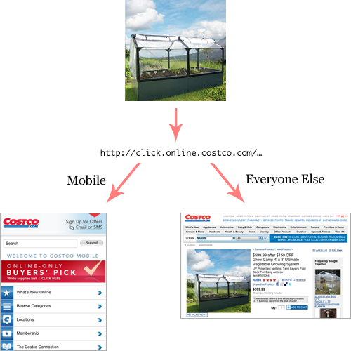

While perusing the latest Costco email, I stumbled onto <a href="http://www.costco.com/Browse/Product.aspx?Prodid=11524865">a pretty sweet looking mini-greenhouse</a> and decided to click through to read more about the product. Unfortunately for me, I was on my phone and Costco is not particularly savvy about how they handle the redirection of mobile traffic to their “mobile friendly” site. Instead of landing on the product page as I should have, I was redirected to the mobile landing page.

<figure></figure>

Now I am not completely sold on the need for creating (and maintaining) an independent mobile version of every website; sometimes it makes sense, but other times it’s overkill. That said, however, I am sure of one thing: <strong>if you do redirect mobile traffic, make sure you do so to an equivalent URI; don’t redirect all requests to the homepage</strong>. When users click a link, they have an expectation of what they will find on the other end of that link. Make sure you meet that expectation.

I can’t speak to Costco’s server setup specifically because it seems their main site is .Net and the mobile version is JSP/Struts (neither of which are my cup of tea), but for those of you running Apache (which more than half of you likely are), setting up proper redirection is relatively easy using an .htaccess file:

<link href="https://github.githubassets.com/assets/gist-embed-c77408be8058.css" rel="stylesheet"/>
 
 
 
 
 
 
 <template class="js-file-alert-template"> 
 <svg aria-hidden="true" class="octicon octicon-alert" data-view-component="true" height="16" version="1.1" viewbox="0 0 16 16" width="16"> <path d="M6.457 1.047c.659-1.234 2.427-1.234 3.086 0l6.082 11.378A1.75 1.75 0 0 1 14.082 15H1.918a1.75 1.75 0 0 1-1.543-2.575Zm1.763.707a.25.25 0 0 0-.44 0L1.698 13.132a.25.25 0 0 0 .22.368h12.164a.25.25 0 0 0 .22-.368Zm.53 3.996v2.5a.75.75 0 0 1-1.5 0v-2.5a.75.75 0 0 1 1.5 0ZM9 11a1 1 0 1 1-2 0 1 1 0 0 1 2 0Z"></path></svg>       This file contains bidirectional Unicode text that may be interpreted or compiled differently than what appears below. To review, open the file in an editor that reveals hidden Unicode characters.      <a class="Link--inTextBlock" href="https://github.co/hiddenchars" target="_blank">Learn more about bidirectional Unicode characters</a>  
 <a class="btn-sm btn" data-view-component="true" href="/archives/on-redirecting-mobile-traffic/{{ revealButtonHref }}">    Show hidden characters</a>

</template><template class="js-line-alert-template">  <svg aria-hidden="true" class="octicon octicon-alert" data-view-component="true" height="16" version="1.1" viewbox="0 0 16 16" width="16"> <path d="M6.457 1.047c.659-1.234 2.427-1.234 3.086 0l6.082 11.378A1.75 1.75 0 0 1 14.082 15H1.918a1.75 1.75 0 0 1-1.543-2.575Zm1.763.707a.25.25 0 0 0-.44 0L1.698 13.132a.25.25 0 0 0 .22.368h12.164a.25.25 0 0 0 .22-.368Zm.53 3.996v2.5a.75.75 0 0 1-1.5 0v-2.5a.75.75 0 0 1 1.5 0ZM9 11a1 1 0 1 1-2 0 1 1 0 0 1 2 0Z"></path></svg></template> <table class="highlight tab-size js-file-line-container js-code-nav-container js-tagsearch-file" data-hpc="" data-paste-markdown-skip="" data-tab-size="8" data-tagsearch-lang="ApacheConf" data-tagsearch-path=".htaccess"> <tr> <td class="blob-num js-line-number js-code-nav-line-number js-blob-rnum" data-line-number="1" id="file-htaccess-L1"></td> <td class="blob-code blob-code-inner js-file-line" id="file-htaccess-LC1"># setup</td> </tr> <tr> <td class="blob-num js-line-number js-code-nav-line-number js-blob-rnum" data-line-number="2" id="file-htaccess-L2"></td> <td class="blob-code blob-code-inner js-file-line" id="file-htaccess-LC2">RewriteEngine on</td> </tr> <tr> <td class="blob-num js-line-number js-code-nav-line-number js-blob-rnum" data-line-number="3" id="file-htaccess-L3"></td> <td class="blob-code blob-code-inner js-file-line" id="file-htaccess-LC3">RewriteBase /</td> </tr> <tr> <td class="blob-num js-line-number js-code-nav-line-number js-blob-rnum" data-line-number="4" id="file-htaccess-L4"></td> <td class="blob-code blob-code-inner js-file-line" id="file-htaccess-LC4"></td> </tr> <tr> <td class="blob-num js-line-number js-code-nav-line-number js-blob-rnum" data-line-number="5" id="file-htaccess-L5"></td> <td class="blob-code blob-code-inner js-file-line" id="file-htaccess-LC5"># product redirection based on iPhone and product request</td> </tr> <tr> <td class="blob-num js-line-number js-code-nav-line-number js-blob-rnum" data-line-number="6" id="file-htaccess-L6"></td> <td class="blob-code blob-code-inner js-file-line" id="file-htaccess-LC6"># note: the user agent check is contrived, you should have </td> </tr> <tr> <td class="blob-num js-line-number js-code-nav-line-number js-blob-rnum" data-line-number="7" id="file-htaccess-L7"></td> <td class="blob-code blob-code-inner js-file-line" id="file-htaccess-LC7"># a much more robust checker</td> </tr> <tr> <td class="blob-num js-line-number js-code-nav-line-number js-blob-rnum" data-line-number="8" id="file-htaccess-L8"></td> <td class="blob-code blob-code-inner js-file-line" id="file-htaccess-LC8">RewriteCond %{HTTP_USER_AGENT} iPhone</td> </tr> <tr> <td class="blob-num js-line-number js-code-nav-line-number js-blob-rnum" data-line-number="9" id="file-htaccess-L9"></td> <td class="blob-code blob-code-inner js-file-line" id="file-htaccess-LC9">RewriteCond %{QUERY_STRING} Prodid=(\d+)</td> </tr> <tr> <td class="blob-num js-line-number js-code-nav-line-number js-blob-rnum" data-line-number="10" id="file-htaccess-L10"></td> <td class="blob-code blob-code-inner js-file-line" id="file-htaccess-LC10">RewriteRule ^Browse\/Product.aspx http://m.costco.com/costco/product/productDirectDetail.do?itemId=%1 [R=301,L]</td> </tr> </table>
 
 

 
 
 <a class="Link--inTextBlock" href="https://gist.github.com/aarongustafson/1250652/raw/02bc4a7d95589a441b3eae35b2c69549b5c9feee/.htaccess" style="float:right">view raw</a> <a class="Link--inTextBlock" href="https://gist.github.com/aarongustafson/1250652#file-htaccess">          .htaccess        </a>        hosted with ❤ by <a class="Link--inTextBlock" href="https://github.com">GitHub</a> 
 

Here’s what this snippet does:

<ul>
<li>Line 2 ensures redirection is on;</li>
<li>Line 3 lets us assume all URIs start with “/”;</li>
<li>Line 8 is a very contrived test for a mobile device by querying the User Agent string being reported by the browser, in a real-world scenario, you will want a much more robust test here;</li>
<li>Line 9 tests for the existence of a “Prodid” value in the query string and captures the actual product ID (in Costco’s case, a series of digits) so we can use it later on; and</li>
<li>Line 10 redirects all requests for “/Browse/​Product.aspx” that pass the two previous tests to “http://m.costco.com/​costco/​product/​productDirectDetail.do” and adds the captured product ID to the query string as “itemId” (“%1” tells Apache to use the digits that were captured on line 9).</li>
</ul>

With this sort of simple redirection in place, you can ensure users get where they want to go, quickly and easily.

